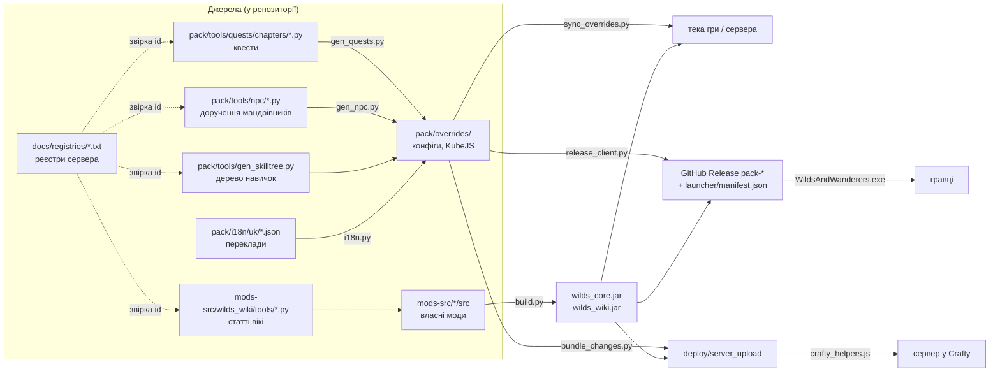

# Мапа проєкту Wilds & Wanderers

Ця мапа пояснює, **з чого складається репозиторій, як частини пов'язані між собою і що змінювати для типової задачі**. Вона для людей і для ШІ-асистентів. Правила роботи над проєктом — у [`AGENTS.md`](AGENTS.md), історія рішень — у [`ПРОГРЕС.md`](ПРОГРЕС.md), опис для гравців — у [`README.md`](README.md).

> **Мапа завжди має відповідати репозиторію.** Після кожної зміни запустіть `python pack/tools/gen_project_map.py`: він перепише покажчик файлів унизу з документації самих файлів і попередить, якщо нова тека ще не описана тут. Розділи 1–7 пишуть люди (або ШІ) вручну. `python pack/tools/install_hooks.py` (один раз на комп'ютер) не дає закомітити застарілу мапу й оновлює граф після кожного коміту.

## Зміст
1. [Що це за проєкт](#1-що-це-за-проєкт)
2. [Як усе пов'язано](#2-як-усе-повязано)
3. [Теки репозиторію](#3-теки-репозиторію)
4. [Власні моди](#4-власні-моди)
5. [Конвеєри: що з чого генерується](#5-конвеєри-що-з-чого-генерується)
6. [Типові задачі: що змінювати](#6-типові-задачі-що-змінювати)
7. [Граф знань (graphify)](#7-граф-знань-graphify)
8. [Покажчик файлів](#8-покажчик-файлів) (генерується)

---

## 1. Що це за проєкт

**Wilds & Wanderers** — українська збірка модів для **Minecraft 1.21.1, NeoForge 21.1.264**: ~170 чужих модів, з'єднаних власними налаштуваннями, рецептами, квестами, перекладом і трьома власними модами. Для гравців є програма встановлення (`WildsAndWanderers.exe`), для гри — сервер у панелі Crafty.

Репозиторій зберігає **лише власну роботу збірки**. Чужих модів (jar), світів, серверів, паролів тут немає: їхні версії й посилання — у `docs/mods.json`, а локальні теки описано в [розділі 3](#теки-поза-репозиторієм).

| Мова | Де | Навіщо |
|---|---|---|
| Java 21 | `mods-src/` | власні моди NeoForge (збираються `javac` без Gradle) |
| Python 3.11+ | `pack/tools/`, `mods-src/*/tools/`, `mods-src/*/build.py` | генератори даних, збірка, тести, випуск, заливка |
| C# / WPF (.NET Framework 4.8) | `launcher/src/` | програма встановлення й оновлення для гравців |
| JavaScript (KubeJS) | `pack/overrides/kubejs/*_scripts/` | рецепти, лут, торгівля, команди всередині гри |
| JSON / SNBT / TOML | `pack/overrides/`, `pack/i18n/` | налаштування модів, квести, переклади, дані |

## 2. Як усе пов'язано

Головне правило: **згенеровані файли не редагують руками.** Квести (`pack/overrides/config/ftbquests/`), доручення (`pack/overrides/kubejs/data/wilds_core/`), дерево навичок (`pack/overrides/kubejs/data/wilds/puffish_skills/`), статті вікі з генераторів — усе це виходи скриптів. Змініть джерело й перезапустіть генератор.

## 3. Теки репозиторію

| Тека | Що там |
|---|---|
| `pack/` | Усе, що потрапляє в теку гри чи сервера, і інструменти, що це роблять. |
| `pack/overrides/` | **Джерело правди** налаштувань: копіюється поверх модів у теку гри й сервера (`sync_overrides.py`). |
| `pack/overrides/config/` | Налаштування модів. Тут же згенеровані квести (`pack/overrides/config/ftbquests/`). Окремі підтеки: `pack/overrides/config/alexscaves_biome_generation/` (умови печер Alex's Caves під Tectonic), `pack/overrides/config/almostunified/` (зведення однакових руд і злитків), `pack/overrides/config/chunky/` (попередня генерація), `pack/overrides/config/easylogin/` (вхід на сервер), `pack/overrides/config/sereneseasons/` (пори року), `pack/overrides/config/servercore/` (оптимізація сервера). |
| `pack/overrides/defaultconfigs/` | Налаштування світу за замовчуванням (копіюються в новий світ). |
| `pack/overrides/kubejs/` | KubeJS. `pack/overrides/kubejs/data/` — дані (теги, рецепти, лут, дерево навичок, доручення `wilds_core/`, виправлення досягнень чужих модів); `pack/overrides/kubejs/assets/` — переклади (`*/lang/uk_ua.json`), текстури, тема книги квестів; `pack/overrides/kubejs/server_scripts/` — рецепти, лут, торгівля, команди, зв'язки між модами; `pack/overrides/kubejs/client_scripts/` — підказки JEI. |
| `pack/overrides/resourcepacks/` | Ресурспак `WildsMusic`: власна музика (Kevin MacLeod, CC BY) і правила Reactive Music. |
| `pack/overrides-initial/` | Налаштування, які копіюються **лише при першому встановленні** (мова, клавіші, відео, сервери): далі ними керує гравець. |
| `pack/server/` | Скрипт нічного вимкнення сервера для Crafty (Docker compose). |
| `pack/tools/` | Python-скрипти: завантаження модів, генератори, переклад, тести, випуск, заливка. Кожен описаний у [покажчику](#8-покажчик-файлів). |
| `pack/tools/quests/` | Генератор книги квестів: `chapters/*.py` (розділи) → `gen_quests.py` → SNBT і мовні файли. |
| `pack/tools/npc/` | Генератор доручень мандрівників (`gen_npc.py` + `quests_*.py`). |
| `pack/tools/i18n/` | Конвеєр перекладу (`i18n.py`) і пакети перекладів окремих модів (`gen_b*.py`). |
| `pack/tools/spawn/` | Пошук місця спавну за сидом і вставка схем будівель. |
| `pack/tools/scenarios/` | Сценарії для тестів на локальному сервері (`join_test.sh`): команди консолі по рядку. |
| `pack/i18n/` | Переклад. `pack/i18n/uk/` — українські файли модів (джерело для `kubejs/assets/*/lang`), `pack/i18n/fixes/` — правки готових перекладів модів, `pack/i18n/mek/` — Mekanism; `glossary.md` — обов'язкова термінологія. |
| `mods-src/` | Власні моди: `mods-src/wilds_core/`, `mods-src/wilds_wiki/`, `mods-src/wilds_dump/` ([розділ 4](#4-власні-моди)). |
| `launcher/` | Програма встановлення: `launcher/src/` (C# / WPF), `launcher/tools/` (картинки програми), `config.json` (сервери, новини), `presets.json` (пресети графіки), `manifest.json` (маніфест збірки; пише `release_client.py`). |
| `docs/` | `mods.json` (усі моди: джерело, версія, SHA-1, сторона), `вибір-модів.md` (чому саме ці моди), `lang-coverage.json`, `docs/registries/` (зліпки реєстрів сервера: предмети, істоти, біоми, споруди — генератори звіряють з ними кожен id). |
| `graphify-out/` | Граф знань коду ([розділ 7](#7-граф-знань-graphify)). |

### Теки поза репозиторієм

Ці теки існують лише на комп'ютері автора (їх відсікає `.gitignore`). Скрипти, що їх використовують, мають шляхи під цей комп'ютер.

| Тека | Що там |
|---|---|
| `client/mods`, `server/mods`, `optional/` | jar-файли модів (`build_neo.py`); `build.py --install` кладе туди власні моди |
| `testserver/` | локальний тестовий сервер (RCON 127.0.0.1:25580), копія виробничого світу |
| `deploy/server_upload/` | пакет для сервера Crafty (`bundle_changes.py`) |
| `_tools/` | Java 21, **паролі RCON** — ніколи не публікувати |
| `pack/overrides-server/` | виправлені шаблони споруд чужих модів, лише для сервера (чужі файли — не публікуються) |

## 4. Власні моди

### Wilds Core (`mods-src/wilds_core/`, id `wilds_core`, клієнт + сервер)
Механіки збірки. Точка входу — `WildsCore.java` (сервер) і `client/WildsCoreClient.java` (клієнт). Пакети (`ua.wilds.core.*`):

| Пакет | Що робить |
|---|---|
| `mods-src/wilds_core/src/main/java/ua/wilds/core/client/` | усе клієнтське: екран спорядження (`gear/`), діалоги з мандрівниками (`npc/`), музика, підказки, самотести (`CmdTest`, `PlaceTest`, `uishot`) |
| `mods-src/wilds_core/src/main/java/ua/wilds/core/npc/` | мандрівники з дорученнями: істота `Wanderer`, розмови `Dialogue`, доручення `NpcQuest` (дані — `kubejs/data/wilds_core/`) |
| `mods-src/wilds_core/src/main/java/ua/wilds/core/skills/` | дерево навичок: стан і нагороди Pufferfish's Skills, досвід (`SkillXp`), гілки (`branch/`) |
| `mods-src/wilds_core/src/main/java/ua/wilds/core/quests/` | міст до FTB Quests: особисті квести в групі, зарахування вбивств усім, хто бив (`KillCredit`), фанфари |
| `mods-src/wilds_core/src/main/java/ua/wilds/core/golem/` | мідний голем-сортувальник: док-станція (`GolemDock`), сортування (`CopperSorter`), тема скрині (`Likeness`), статуси скринь |
| `mods-src/wilds_core/src/main/java/ua/wilds/core/finder/` | пошук предметів у скринях поруч (серверна частина; клієнтська — `client/gear/FinderField`) |
| `mods-src/wilds_core/src/main/java/ua/wilds/core/world/` | світ: валюти, клік по рамці крізь скриню, фільтр технічних зачарувань у луті |
| `mods-src/wilds_core/src/main/java/ua/wilds/core/worldgen/` | генерація світу: біоми Alex's Caves під Lithostitched (`CaveBiomes`), захист від накладання споруд (`StructureGuard`), аудит `/wildsgen` |
| `mods-src/wilds_core/src/main/java/ua/wilds/core/mixin/` | міксини у ванілу й чужі моди; міксин для мода, якого немає, вимикає `WildsMixinPlugin` (мапа `NEEDS`) |
| `mods-src/wilds_core/src/main/java/ua/wilds/core/net/` | мережеві пакети (`Net.java`); усі необов'язкові, тож клієнт без мода може зайти |

Ресурси: `src/main/resources/` (мова, текстури блока станції, рецепти, `structure_footprints.json`, `wilds_core.mixins.json`). Збірка: `python mods-src/wilds_core/build.py [--install]`.

### Wilds Wiki (`mods-src/wilds_wiki/`, id `wilds_wiki`, лише клієнт)
Вікі в грі (клавіша O). Пакети (`ua.wilds.wiki.*`):

| Пакет | Що робить |
|---|---|
| `mods-src/wilds_wiki/src/main/java/ua/wilds/wiki/data/` | індекс: сторінки всіх предметів, істот, біомів, споруд, статей, категорій і модів (`WikiData`, `Entry`, `Article`), історія й остання сторінка |
| `mods-src/wilds_wiki/src/main/java/ua/wilds/wiki/ui/` | екран (`WikiScreen`), будова сторінки (`PageBuilder`: опис → як отримати → використання → характеристики), елементи, самотест |
| `mods-src/wilds_wiki/src/main/java/ua/wilds/wiki/search/` | нечіткий пошук: помилки, розкладка, транслітерація |
| `mods-src/wilds_wiki/src/main/java/ua/wilds/wiki/jei/` | рецепти JEI на сторінках, порядок видів рецептів |
| `mods-src/wilds_wiki/src/main/java/ua/wilds/wiki/mixin/` | пошук у налаштуваннях |

Дані: статті `src/main/resources/assets/wilds_wiki/wilds_wiki/uk_ua/**.md` (формат — у Javadoc `Article.java`), розділи головної `categories.json`, сторінки модів `mods.json`, згенеровані таблиці `generated/` (лут, світ, книги модів). Генератори й перевірка — `mods-src/wilds_wiki/tools/` ([розділ 5](#5-конвеєри-що-з-чого-генерується)).

### Wilds Dump (`mods-src/wilds_dump/`, лише для тесту)
Знімає з тестового сервера біоми, споруди й торгівлю (`/wildsdump`) для `generated/world.json` вікі. У збірку не входить.

## 5. Конвеєри: що з чого генерується

| Що | Джерело | Команда | Куди |
|---|---|---|---|
| Книга квестів | `pack/tools/quests/chapters/c*.py` | `python pack/tools/quests/gen_quests.py` | `pack/overrides/config/ftbquests/`, `kubejs/data/wilds_core/quests/gates.json` |
| Доручення мандрівників | `pack/tools/npc/quests_*.py` | `python pack/tools/npc/gen_npc.py` | `pack/overrides/kubejs/data/wilds_core/` |
| Дерево навичок + сторінка вікі | `pack/tools/gen_skilltree.py` | `python pack/tools/gen_skilltree.py pack/overrides` | `kubejs/data/wilds/puffish_skills/`, `skills.md` |
| Фон дерева навичок | `pack/tools/gen_skilltree_bg.py` | так само | `kubejs/assets/wilds/textures/gui/skilltree.png` |
| Переклад | `pack/i18n/uk/` | `python pack/tools/i18n/i18n.py …` | `pack/overrides/kubejs/assets/*/lang/uk_ua.json` |
| Вікі: підказки квестів | розділи квестів | `python mods-src/wilds_wiki/tools/gen_quest_guides.py` | `wilds_wiki/uk_ua/quest_guides/` |
| Вікі: боси, проходження, часті питання | `tools/gen_bosses.py`, `bosses_more.py`, `gen_guides.py` | ці ж скрипти | `wilds_wiki/uk_ua/guides/` |
| Вікі: розділи й моди | `tools/gen_catalogue.py`, `mods_text.json` | `gen_catalogue.py` | `categories.json`, `mods.json` |
| Вікі: описи зачарувань | `tools/ench_texts.py` | цей скрипт | `lang/uk_ua.json` |
| Вікі: перевірка посилань | усі статті | `python mods-src/wilds_wiki/tools/check_links.py` | — (код виходу 1 при битих посиланнях) |
| Власні моди | `mods-src/*/src` | `python mods-src/<мод>/build.py --install` | `build/*.jar` → `client/`, `server/`, `testserver/mods` |
| Реліз для гравців | усе вище | `python pack/tools/release_client.py` (`--app` — програма) | GitHub Release `pack-<версія>`, `launcher/manifest.json` |
| Заливка на сервер | `pack/overrides`, jar | `python pack/tools/bundle_changes.py` → `crafty_helpers.js` у браузері | `deploy/server_upload/` → Crafty |
| Мапа проєкту | документація файлів | `python pack/tools/gen_project_map.py` | цей файл, розділ 8 |

**Тести** (локально, з шляхами автора): `pack/tools/restart_test.sh` (перезапуск тестового сервера), `pack/tools/join_test.sh` (клієнт заходить, виконує сценарій і самотести через `-Dwilds_core.cmdtest=…`, `-Dwilds_core.placetest=…`, `-Dwilds_core.uishot=true`, `-Dwilds_wiki.selftest=true`), `/wildsgen РАДІУС` (аудит генерації світу), `/wildssort x y z [предмет]` (чому голем кладе предмет у скриню).

## 6. Типові задачі: що змінювати

| Задача | Що робити |
|---|---|
| Додати чи змінити квест | розділ у `pack/tools/quests/chapters/` → `gen_quests.py` (звіряє id з `docs/registries/`) → `gen_quest_guides.py` для вікі |
| Додати доручення мандрівника | `pack/tools/npc/quests_*.py` → `gen_npc.py` |
| Змінити навичку | `pack/tools/gen_skilltree.py` (опис і вузли) + реалізація в `wilds_core/skills/branch/`; нова здатність — ще й `skills/Ability.java` |
| Змінити рецепт, лут, торгівлю | `pack/overrides/kubejs/server_scripts/` |
| Змінити налаштування мода | `pack/overrides/config/<мод>` (на сервері правити наявний файл, а не перезаписувати) |
| Перекласти мод | `pack/i18n/uk/<мод>.json` за `pack/i18n/glossary.md` → `i18n.py` |
| Нова механіка в грі | пакет у `mods-src/wilds_core/`; міксин у чужий мод — у `WildsMixinPlugin.NEEDS` |
| Стаття вікі | `.md` у `wilds_wiki/uk_ua/` (або генератор у `mods-src/wilds_wiki/tools/`), потім `check_links.py` |
| Новий розділ вікі | `mods-src/wilds_wiki/tools/gen_catalogue.py` |
| Додати чи прибрати мод | `pack/tools/build_neo.py` (список), `docs/mods.json`, `docs/вибір-модів.md`; прибраний — у `pack/removed.txt` (його файли відкладаються, не видаляються) |
| Програма встановлення | `launcher/src/WildsLauncher/`; версія в `.csproj`, випуск `release_client.py --app` |

Після будь-якої з них: перевірити (тест / генератор без помилок), `python pack/tools/gen_project_map.py`, запис у `ПРОГРЕС.md`.

## 7. Граф знань (graphify)

`graphify-out/` — граф коду всього репозиторію, зібраний [graphify](https://github.com/safishamsi/graphify): кілька тисяч вузлів і зв'язків, згрупованих за підсистемами (класи, функції, виклики, імпорти, а також поняття з `README.md`, `ПРОГРЕС.md`, `docs/вибір-модів.md`). Дані (переклади, квести, статті) у граф не входять — список виключень у `.graphifyignore`.

| Файл | Для кого |
|---|---|
| `graphify-out/GRAPH_REPORT.md` | людина або ШІ: розміри графа, головні вузли, групи, несподівані зв'язки |
| `graphify-out/graph.json` | ШІ: `graphify query "питання"`, `graphify path "A" "B"`, `graphify explain "Клас"` |
| `graph.html` | інтерактивна картина; не зберігається в репозиторії — зробіть локально: `graphify export html` |

Оновлення: `graphify update .` (лише код, без LLM, кілька секунд) — після кожного коміту це робить хук з `install_hooks.py`. Документи (`*.md`) граф перечитує лише при повному `/graphify . --update`.

## 8. Покажчик файлів

<!-- index:begin (generated by pack/tools/gen_project_map.py, do not edit by hand) -->

Every code file of the repository (264), with the first sentence of its own documentation.

### `launcher/src/WildsLauncher/`

| File | What it is |
|---|---|
| `App.xaml` | The application: shared resources (Theme.xaml) and shutdown when the main window closes. |
| `App.xaml.cs` | Start-up. |
| `MainWindow.xaml` | The installer window: header with news, graphics presets, install/update and uninstall buttons, Minecraft folder choice, progress. |
| `MainWindow.xaml.cs` | the parts of the window that come from the pack: news, presets, server, memory |
| `Theme.xaml` | Colours, brushes and control styles of the installer (gold on dark slate). |

### `launcher/src/WildsLauncher/Core/`

| File | What it is |
|---|---|
| `Engine.cs` | One run of the program: read what the pack wants (config, manifest, presets from the repository), compare it with the game folder, bring everything up to date, then hand over to… |
| `GameStarter.cs` | Starts the official Minecraft launcher (the player signs in and plays there, with the pack's installation). |
| `GraphicsPresets.cs` | Applies a graphics preset to the game's own setting files: options.txt (Minecraft and Sodium), Distant Horizons and Iris (shaders). |
| `Json.cs` | JSON with what .NET Framework has built in (no extra libraries next to the exe): objects are Dictionary&lt;string, object&gt;, arrays object[], numbers int/long/decimal. |
| `LauncherProfiles.cs` | The pack's installation in the official launcher: the pack's version and the memory for the game (other launchers find the version in .minecraft/versions by themselves). |
| `Log.cs` | A plain text log next to the program's data; with --headless it is also printed to the console. |
| `Model.cs` | A file the pack installs: where it goes in the game folder, its hash, where to get it. |
| `NeoForge.cs` | NeoForge for the official launcher: its own installer, run headless into .minecraft. |
| `Net.cs` | Downloads over HTTPS from the hosts the pack uses, each file checked against the hash the manifest gives before it replaces anything; a broken or tampered download never reaches… |
| `PackSync.cs` | 0..1, or below 0 when the length of the step is unknown |
| `Paths.cs` | Where things live. |
| `SelfUpdate.cs` | The program updates itself from the release config.json names: the new exe is downloaded beside the running one, checked (SHA-256), swapped in by renaming (Windows lets a running… |
| `ServersDat.cs` | The game's server list (servers.dat, Minecraft's NBT format). |
| `SharedMinecraft.cs` | The pack in the shared .minecraft, the folder every launcher reads: its own version in versions/ (so it is in any launcher's list), its mods in mods/ (mods of something else that… |
| `Store.cs` | The player's choices in this program: the graphics preset, the memory for the game, the Minecraft folder. |
| `Uninstaller.cs` | What removing the pack takes away, and what it gives back. |
| `Upscaler.cs` | DLSS / FSR / XeSS through the Super Resolution mod, installed only when the player ticks it. |

### `launcher/tools/`

| File | What it is |
|---|---|
| `make_art.py` | The program's background and icon, drawn in code (no borrowed artwork): python make_art.py -> ../src/WildsLauncher/Assets/{background.png, icon.png, icon.ico} |

### `mods-src/wilds_core/`

| File | What it is |
|---|---|
| `build.py` | Build Wilds Core (the pack's own gameplay mod: music director, skills, quest-giver NPCs) without Gradle: javac against the libraries the launcher installed, like the wiki mod. |

### `mods-src/wilds_core/src/main/java/ua/wilds/core/`

| File | What it is |
|---|---|
| `LogNoise.java` | Lines the game writes for nothing a player or an admin can act on, kept out of the log so real errors stand out. |
| `OpBreak.java` | Operators (permission level 2 and up) can break, in survival, the chests and other containers of structures that mods protect: Lootr's (only while sneaking otherwise), Twilight… |
| `PartyPeace.java` | Friends do not hurt each other: players in the same party (Open Parties and Claims, the one that also shares the players' positions on the map) or in the same FTB Teams party (the… |
| `WildsCore.java` | Wilds Core: the pack's own gameplay. |

### `mods-src/wilds_core/src/main/java/ua/wilds/core/client/`

| File | What it is |
|---|---|
| `AllRecipes.java` | Every recipe in the recipe book from the start (see mixin.RecipeBookKnowsMixin): once the recipes of the server have come and the player exists, all that are not "special" (maps,… |
| `ArmorNumber.java` | The armour value as a number. |
| `CmdTest.java` | -Dwilds_core.cmdtest=step;step...: from 35 s after joining, every 10 s, the player runs the next step: a command (without the slash, "+" for spaces), "@key.name" to press that key… |
| `FirstRunDefaults.java` | The pack's defaults the game's own settings file does not keep on its own, applied once per game folder: the game in Ukrainian, and the quest book on J (FTB Quests ships its key… |
| `KeyLayout.java` | The pack's key layout. |
| `PlaceTest.java` | -Dwilds_core.placetest=x,y,z[;x,y,z...]: from 35 s after joining, every 10 s, the player uses what is in hand on the top of the next of those blocks (places a block, or opens a… |
| `SkillInput.java` | Inputs of the abilities that need the player's hands: weapon throw: with the use button held and a melee weapon in hand, the attack button throws it; heavy strike: holding its own… |
| `SortTitle.java` | The copper golem's status of a storage (Звичайна, Джерело, Різне, Не чіпати), on the same line as the storage's title when it is open, after the name the player gave it (which the… |
| `TutorialTracker.java` | Tells the server when the player opens an interface the start quests teach (quest book, wiki, skills, map...), by the screen's class name, so it works with whatever version of… |
| `WildsCoreClient.java` | Client side of Wilds Core. |

### `mods-src/wilds_core/src/main/java/ua/wilds/core/client/gear/`

| File | What it is |
|---|---|
| `AttributesPanel.java` | «Характеристики»: the player's attributes (health, armour, damage, speed, mana, spell power, crit, dodge... |
| `EffectsPanel.java` | The player's effects (poison, weakness, potions...) on the equipment screen. |
| `FinderField.java` | Item finder, the client half: a search field in the inventory. |
| `GearLayout.java` | The parts of the equipment screen's own layout (Accessories draws it with owo-lib) the pack changes; only touched when that screen is open, so without Accessories this class is… |
| `GearScreens.java` | One equipment screen. |
| `RecipeBookPanel.java` | The vanilla recipe book on the equipment screen. |

### `mods-src/wilds_core/src/main/java/ua/wilds/core/client/music/`

| File | What it is |
|---|---|
| `MusicDirector.java` | Decides what the fight music should be, every few ticks, from what the client can see: a boss fight: an entity of the boss tag (or of the pack's extra list) is near and engaged -… |
| `MusicPack.java` | The pack's Reactive Music songpack, resourcepacks/WildsMusic: its rules (ReactiveMusic.yaml) and its own tracks come with the pack; the songs it borrows from Reactive Music's… |
| `ReactiveMusicBridge.java` | Talks to Reactive Music by reflection, so the pack runs the same without it: sets its BOSS / NEARBY_MOBS flags and asks it to fall silent while a boss theme of ours plays. |

### `mods-src/wilds_core/src/main/java/ua/wilds/core/client/npc/`

| File | What it is |
|---|---|
| `DialogueCamera.java` | The camera of a conversation: it glides from the player's eyes to a close shot of the NPC's face, a little to the side, as in Fallout or The Outer Worlds, and back when the… |
| `DialogueScreen.java` | A conversation page: the NPC's name and words in a dark panel across the lower part of the screen (the world and the NPC's face stay visible above it), the text appearing letter… |
| `WandererRenderer.java` | A quest giver looks like a player with one of Minecraft's own skins (wide or slim arms) and carries a sign above the name, bobbing, so they are noticed from afar: a gold "!" (a… |

### `mods-src/wilds_core/src/main/java/ua/wilds/core/finder/`

| File | What it is |
|---|---|
| `Finder.java` | Item finder, the server half. |

### `mods-src/wilds_core/src/main/java/ua/wilds/core/golem/`

| File | What it is |
|---|---|
| `CopperSorter.java` | The copper golem as a sorter, on Friends &amp; Foes' golem (its model, animations and oxidation stay). |
| `GolemDock.java` | The copper golem's docking station: a copper pad with a back panel, like a robot vacuum's. |
| `Golems.java` | registers the copper golem sorter; called only with Friends &amp; Foes installed, whose classes it uses |
| `Likeness.java` | What a storage is "about", for the copper golem's sorting by likeness. |
| `SortStatus.java` | What the copper golem does with a storage, set by the player (sneak + right click with an empty hand, round and round) and kept in the storage's block entity, never in its name:… |

### `mods-src/wilds_core/src/main/java/ua/wilds/core/mixin/`

| File | What it is |
|---|---|
| `AccessoriesArmorShiftMixin.java` | Shift-click from a worn armour piece in the equipment screen: Accessories counts its armour slots from 43, but the helmet's is 42 (the slots go helmet, cosmetic helmet,… |
| `AccessoriesResultSlotMixin.java` | The equipment screen (Accessories) is a recipe-book menu with a crafting grid, but reports its result slot as -1. |
| `AnvilSmithMixin.java` | Skill smith_hands: work on the anvil costs fewer levels (CraftSkills#anvilCost), on both sides so the price shown is the price paid. |
| `BiomeClimateMixin.java` | The climate a biome is chosen by, in the overworld far from the spawn: see worldgen.CaveBiomes#climate. |
| `CopperGolemStatueMixin.java` | Friends and Foes 5.0.3: a copper golem that oxidizes all the way turns into a statue and, on the server too, sends its walking animation "to the server" (a client-only message):… |
| `EnchantRandomlyMixin.java` | "enchant_randomly" without a list of enchantments: never a technical one (world.Enchants). |
| `EnchantWithLevelsMixin.java` | "enchant_with_levels" without a list of enchantments: never a technical one (world.Enchants). |
| `FtbQuestsPartyMixin.java` | Personal quests in parties (see FtbQuestsTeamMixin): joining or leaving a party neither merges nor moves quest progress. |
| `FtbQuestsTeamMixin.java` | Personal quests in parties. |
| `ItemStackDurabilityMixin.java` | Perk tool_saver: each point of wear a player's tool or weapon would take is skipped with that chance (max 75%). |
| `LithostitchedSourceMixin.java` | The source a biome injector wraps (worldgen.CaveBiomes). |
| `MobAccessor.java` | Hired golems and guards get extra goals (follow and defend the player who paid). |
| `OpBreakMixin.java` | OpBreak: an operator digs a container that its mod made unbreakable (Lootr, Twilight Forest, the Aether) like a chest. |
| `RecipeBookKnowsMixin.java` | The recipe book shows only recipes the player has "unlocked", and unlocking is an advancement every recipe must bring with it: many mods' recipes bring none, so the book never… |
| `StructureGuardCheckMixin.java` | /locate, maps and compasses ask here whether a structure can stand at a place not generated yet. |
| `StructureGuardMixin.java` | See worldgen.StructureGuard. |
| `VillagerPricesMixin.java` | The trader's discount: right after the villager has worked out its prices for this player (reputation, Hero of the Village), every offer gets cheaper by the player's discount. |
| `WildsMixinPlugin.java` | Mixins into other mods apply only when that mod is installed: "client.RMSongPickerMixin" needs Reactive Music. |

### `mods-src/wilds_core/src/main/java/ua/wilds/core/mixin/client/`

| File | What it is |
|---|---|
| `ApothTooltipMixin.java` | Apotheosis' buttons (the world tier screen's tiers, the augmenting table) drew their tooltips in the middle of the screen's own drawing, not after it as the vanilla game does. |
| `CameraMixin.java` | During a conversation the camera is placed by DialogueCamera (detached, so the player's body is drawn, no hand). |
| `ContainerTitleAccessor.java` | where a container screen draws its title, so the copper golem's status goes right after it (SortTitle) |
| `DhClientWorldMixin.java` | Distant Horizons keeps one LOD database per dimension, in a folder named after the server (as the player named it in the server list, URL-encoded: "Український сервер" becomes… |
| `FtbTeamsSelfMixin.java` | FTB Teams finds the player among the players it knows by the launcher session's UUID. |
| `RMSongPickerMixin.java` | Reactive Music decides its situation flags in SongPicker.tickEventMap(); right after that the music director corrects two of them: BOSS (it also sees bosses whose mod draws its… |

### `mods-src/wilds_core/src/main/java/ua/wilds/core/net/`

| File | What it is |
|---|---|
| `Net.java` | Network messages of Wilds Core. |

### `mods-src/wilds_core/src/main/java/ua/wilds/core/npc/`

| File | What it is |
|---|---|
| `Dialogue.java` | Conversations with quest givers. |
| `NpcQuest.java` | One quest a wandering NPC can give, read from data/wilds_core/npc_quests/*.json (made by pack/tools/npc/gen_npc.py from the stories in pack/tools/npc/quests_*.py). |
| `NpcWorld.java` | Where wandering quest givers come from and what happens to them: the first time a player stands inside a structure (above ground or below), there is a chance a quest giver is… |
| `Wanderer.java` | A wandering quest giver ("Мандрівник з дорученням"): a person with a story, standing somewhere in a structure. |

### `mods-src/wilds_core/src/main/java/ua/wilds/core/quests/`

| File | What it is |
|---|---|
| `FtbBridge.java` | Everything Wilds Core does to FTB Quests. |
| `KillCredit.java` | Who a kill counts for in the quests. |
| `PersonalQuests.java` | Quests are personal now, also in a party (FtbQuestsTeamMixin). |
| `QuestData.java` | What the quest generator (pack/tools/quests/gen_quests.py) tells Wilds Core, from the server data (kubejs/data/wilds_core/quests/*.json): which quests every new player gets… |
| `QuestFanfare.java` | A finished quest is felt, not only read in a toast: a chime and a short swirl of golden sparks around the player; a finished chapter gets the "challenge complete" fanfare and a… |
| `Quests.java` | The quest book side of Wilds Core: pins the start quests for a new player (once), completes the custom tutorial tasks when the client reports that the player opened an interface,… |

### `mods-src/wilds_core/src/main/java/ua/wilds/core/skills/`

| File | What it is |
|---|---|
| `Ability.java` | Every big ability the skill tree can unlock. |
| `ClientAbilities.java` | The local player's abilities as the server last sent them (only the client fills this). |
| `LegacyRows.java` | The extra inventory rows of the removed skill branch Торба are gone, but players still have what they kept in them: the storage stays registered (an unknown attachment would be… |
| `Perks.java` | Small numeric bonuses of the tree that are not attributes. |
| `SkillRewards.java` | Reward types of the skill tree (registered with Pufferfish's Skills): wilds_core:stat {attribute, value, operation, fallback?: {attribute, value, operation}} - an attribute bonus;… |
| `SkillState.java` | What the skill tree gives a player right now: ability levels and perk values. |
| `SkillXp.java` | Skill experience for living in the world, besides fights and ores (those are Pufferfish's own sources in the tree's experience.json): travelling on foot, swimming, riding, sailing… |
| `Skills.java` | The skill tree's own mechanics. |
| `ThrownWeapon.java` | A melee weapon thrown with the warrior's "Метальник" ability: flies like a thrown trident, deals the given damage to the first creature it hits and comes back to the thrower's… |

### `mods-src/wilds_core/src/main/java/ua/wilds/core/skills/branch/`

| File | What it is |
|---|---|
| `CombatSkills.java` | Воїн. |
| `CraftSkills.java` | Майстер. |
| `DiplomatSkills.java` | Дипломат. |
| `ExplorerSkills.java` | Слідопит. |
| `HunterSkills.java` | Мисливець. |
| `IronsMana.java` | The mage abilities that work with Iron's Spells' mana; loaded only when that mod is installed. |
| `MagicSkills.java` | Маг. |
| `SeaSkills.java` | Мореплавець. |
| `TraderSkills.java` | Торговець. |

### `mods-src/wilds_core/src/main/java/ua/wilds/core/world/`

| File | What it is |
|---|---|
| `Currencies.java` | The pack's money: emeralds (villagers, wandering traders, quest givers, bounty boards) and goblin coins (the goblins of Goblin's Tyranny). |
| `Enchants.java` | Loot that asks for "a random enchantment" without saying which (loot tables of mods written before 1.21) gets one out of every enchantment of the game, also the technical ones… |
| `FrameClick.java` | An item frame on a chest shows what is inside, and a click meant for the chest used to turn the item in the frame. |

### `mods-src/wilds_core/src/main/java/ua/wilds/core/worldgen/`

| File | What it is |
|---|---|
| `CaveBiomes.java` | Alex's Caves puts its cave biomes in from inside MultiNoiseBiomeSource, and only once it knows which level the source belongs to: it looks for a level whose generator has exactly… |
| `StructureGuard.java` | Big surface structures of different mods do not know about each other: a castle grows through a village, two ports share a bay. |
| `WorldgenAudit.java` | /wildsgen RADIUS (operators): asks the overworld's real generator, on background threads and without loading a chunk, which biomes it gives (a 3D grid around the spawn) and which… |

### `mods-src/wilds_dump/`

| File | What it is |
|---|---|
| `build.py` | Build the Wilds Dump dev mod (test server only) without Gradle: javac against the libraries the launcher installed. |

### `mods-src/wilds_dump/src/main/java/ua/wilds/dump/`

| File | What it is |
|---|---|
| `WildsDump.java` | Development helper for the Wilds Wiki, used only on the local test server (never shipped to players). |

### `mods-src/wilds_wiki/`

| File | What it is |
|---|---|
| `build.py` | Build the Wilds Wiki client mod without Gradle: javac against the libraries the launcher installed. |

### `mods-src/wilds_wiki/src/main/java/ua/wilds/wiki/`

| File | What it is |
|---|---|
| `WildsWiki.java` | Wilds Wiki: press O (or /wiki, /вікі) for the encyclopedia of the pack. |

### `mods-src/wilds_wiki/src/main/java/ua/wilds/wiki/data/`

| File | What it is |
|---|---|
| `Article.java` | A hand-written article: assets/&lt;ns&gt;/wilds_wiki/&lt;lang&gt;/&lt;name&gt;.md --- for: iceandfire:fire_dragon, entity:iceandfire:ice_dragon (pages it is shown on; "kind:"… |
| `Entry.java` | One page of the wiki: an item (with its block, if it places one), a block without item, a mob, an effect, a biome... |
| `History.java` | Recent searches, recently opened pages and bookmarks, kept in config/wilds_wiki_history.json of the game folder. |
| `Recent.java` | What is around the player, for the wiki's "Тут і зараз" list: the last biomes (caves included: underground the biome is the cave's), the dimension, the last mobs seen nearby, the… |
| `WikiData.java` | Everything the wiki knows, built once per world and language: entries, articles, loot sources, the search index. |

### `mods-src/wilds_wiki/src/main/java/ua/wilds/wiki/jei/`

| File | What it is |
|---|---|
| `Jei.java` | Everything the wiki asks JEI. |
| `RecipeView.java` | A JEI recipe drawn inside a wiki page. |
| `WikiJeiPlugin.java` | The wiki's JEI plugin: keeps the JEI runtime for recipe views on wiki pages, opens a page from JEI (the wiki key over an ingredient) and frames in gold the recipes the pack added… |

### `mods-src/wilds_wiki/src/main/java/ua/wilds/wiki/mixin/`

| File | What it is |
|---|---|
| `RsoSearchSessionMixin.java` | Reese's Sodium Options settings search: word matching with typos and synonyms instead of loose n-grams. |

### `mods-src/wilds_wiki/src/main/java/ua/wilds/wiki/search/`

| File | What it is |
|---|---|
| `Searcher.java` | Ranked fuzzy search over documents with weighted fields. |
| `SettingsSearch.java` | Search for the video settings screen (Reese's Sodium Options): whole words instead of letter n-grams, so "дощ" finds rain settings and not lava or sculk sensors. |
| `Text.java` | Text folding for search: one spelling for letters people mix up, transliteration and keyboard layout swaps. |

### `mods-src/wilds_wiki/src/main/java/ua/wilds/wiki/ui/`

| File | What it is |
|---|---|
| `Elements.java` | Building blocks of a wiki page. |
| `Page.java` | What page elements can ask of the screen that shows them. |
| `PageBuilder.java` | Turns an entry into page elements: article first, then everything the game itself can tell about the thing. |
| `PhotoMode.java` | Development only, started with -Dwilds_wiki.photos=&lt;shots.json&gt; on the local test server: flies the (spectator, op) player to every camera point of the list, waits until the… |
| `Photos.java` | Photos of structures and biomes ship as small JPEGs (a PNG of a landscape is several times bigger): assets/wilds_wiki/photos/ &lt;structure\|biome&gt;/&lt;ns&gt;/&lt;path&gt;.jpg. |
| `RichText.java` | Inline markup of articles: **bold**, *italic*, `highlight`, [[ref]] and [[ref\|text]] links to other pages. |
| `SelfTest.java` | Started with -Dwilds_wiki.selftest=true: once in a world, searches, builds every page, shows a set of pages and saves screenshots (screenshots/wiki_*.png), then writes… |
| `Theme.java` | Colours and small drawing helpers of the wiki: dark slate panels, amber accent, soft blue links. |
| `WikiScreen.java` | The wiki: search and results on the left, the page on the right, back/forward like a browser. |

### `mods-src/wilds_wiki/tools/`

| File | What it is |
|---|---|
| `bosses_more.py` | More boss guides for gen_bosses.py: Ice and Fire (from its Bestiary), Alex's Caves (its Cave Codex), Alex's Mobs (its Animal Dictionary), Iron's Spells, Ars Nouveau, Friends &… |
| `check_links.py` | Checks every link of every article against what exists: [[refs]], "for:" targets, !items, pages of categories.json. |
| `ench_texts.py` | What every enchantment does, for those whose mods ship no description (all of vanilla, Dungeons and Taverns). |
| `gen_books.py` | Collect what the mods themselves write about their things, so a wiki page says at least what the in-game guide says. |
| `gen_bosses.py` | Boss guides: one article per boss, on the boss's page and in the «Боси» category. |
| `gen_catalogue.py` | The wiki's catalogue: the categories of the home page (categories.json) and one line about every mod (mods.json). |
| `gen_data.py` | Generate the data files the wiki reads at runtime from the mod jars of the pack. |
| `gen_guides.py` | Walkthroughs of the dimensions and the «Часті питання» answers. |
| `gen_loot_names.py` | Ukrainian names of the loot tables listed in generated/loot_tables.txt, written as lang keys wilds_wiki.loot... |
| `gen_quest_guides.py` | Every FTB quest of the pack becomes a short wiki article on the pages of what the quest asks for (its items and mobs): the quest text and its guide (where, how dangerous, what to… |
| `gen_structure_names.py` | Names of every structure of the pack for the wiki: lang/uk_ua.structures.json and lang/en_us.structures.json (build.py merges them into the lang files), keys… |
| `gen_world.py` | Turn what the test server saw (wilds_dump mod: /wildsdump biomes\|structures\|trades) into generated/world.json for the wiki. |
| `pack_photos.py` | Screenshots from PhotoMode (game dir/wiki_photos///.png) -> small JPEGs the wiki ships: src/main/resources/assets/wilds_wiki/photos///.jpg (400x225, ~20 KB each). |
| `split_guides.py` | Split the guide bundles in guides_src/*.txt into articles: guides_src/.txt -> wilds_wiki/uk_ua/guides//.md. |

### `pack/overrides/kubejs/client_scripts/`

| File | What it is |
|---|---|
| `wilds_jei.js` | JEI "information" pages for the cross-mod links added in server_scripts/wilds_links.js, so players can see in the recipe viewer why an item suddenly works in another mod's recipes. |

### `pack/overrides/kubejs/server_scripts/`

| File | What it is |
|---|---|
| `wilds_commands.js` | Wilds & Wanderers: player-facing commands behind the inventory sidebar buttons. |
| `wilds_links.js` | Wilds & Wanderers: links between mods that do not know about each other. |
| `wilds_loot.js` | Wilds & Wanderers: loot from every mod turns up in the chests of every other. |
| `wilds_nether_end.js` | Wilds & Wanderers: the Nether and the End update (28.10). |
| `wilds_ore_magnet.js` | Generated by pack/tools/gen_ore_magnet.py - do not edit by hand. |
| `wilds_spawn.js` | Wilds & Wanderers: protected world spawn. |
| `wilds_trades.js` | Wilds & Wanderers: villagers trade the goods of the pack's mods, so a village is worth visiting for an engineer, a mage or a sailor too. |

### `pack/server/`

| File | What it is |
|---|---|
| `night_shutdown.py` | Нічне вимкнення: the TrueNAS app that switches the Wilds & Wanderers server box off at night. |

### `pack/tools/`

| File | What it is |
|---|---|
| `build_neo.py` | Resolve and download the Wilds & Wanderers NeoForge 1.21.1 pack (Modrinth + CurseForge). |
| `build_songpack.py` | Build the pack's Reactive Music songpack into a game folder: resourcepacks/WildsMusic. |
| `bundle_changes.py` | Refresh the server upload bundle and list what changed since the last upload. |
| `cors_serve.py` | Serve a folder on 127.0.0.1 with CORS (incl. |
| `crafty_helpers.js` | Helpers for driving the Crafty 4 API from a logged-in browser tab of the panel. |
| `depcheck_neo.py` | Check NeoForge mod dependencies in a mods folder (neoforge.mods.toml, incl. |
| `dump_registries.sh` | Dump registries of the running local test server into docs/registries (quest generator checks ids against them). |
| `fix_dungeons_arise.py` | When Dungeons Arise 2.1.68 has a typo: the Mechanical Nest's jigsaw blocks ask for the template pool "dungeons_arise:mechanical_nest/mechanical_nest_decoration", the mod ships it… |
| `fix_nomadictents_advancements.py` | Rewrite Nomadic Tents recipe advancements into the 1.21 format (they fail to parse as shipped). |
| `fix_structure_attributes.py` | Structure templates saved by Minecraft 1.21.2+ name entity attributes the new way ("minecraft:armor"); 1.21.1 knows them as "minecraft:generic.armor" /… |
| `gen_illager_font.py` | Cyrillic for Minecraft's two rune fonts: the illager runes (minecraft:illageralt) and the enchanting table's Standard Galactic (minecraft:alt). |
| `gen_loot_inject.py` | Write the pack's loot tables: injected chest loot (kubejs/data/wilds/loot_table/inject/*.json) and the quest reward bundles (kubejs/data/wilds/loot_table/reward/*.json). |
| `gen_ore_magnet.py` | Write kubejs/server_scripts/wilds_ore_magnet.js: the Twilight Forest Ore Magnet pulls the ores of every mod. |
| `gen_project_map.py` | Keeps PROJECT_MAP.md true: writes its file index from the code itself and checks that the map covers the repository. |
| `gen_quest_theme.py` | The quest book's look: a traveller's journal instead of FTB's grey squares. |
| `gen_questborne.py` | Write the pack's Questborne data into kubejs/data/questborne/questborne/ (a datapack over the mod's own): |
| `gen_skilltree.py` | Generate the radial skill tree «Шлях мандрівника» for Pufferfish's Skills (with Wilds Core's reward types). |
| `gen_skilltree_bg.py` | The background of the skill tree «Шлях мандрівника»: a dark linen cloth embroidered in cross-stitch, every branch in its own thread under it, ornaments on the borders between… |
| `incompat_check.py` | List mods that declare another installed mod as incompatible/discouraged (neoforge.mods.toml, incl. |
| `install_hooks.py` | Installs the repository's git hooks on this computer (hooks are not cloned with the repository). |
| `item_ids.py` | All item ids that exist in the pack: every assets//models/item/.json in the client jars plus vanilla. |
| `join_test.sh` | Join test against the LOCAL test server: launch the client with auto-join, wait until the server log says the player joined (or failed), keep the player online for STAY seconds,… |
| `launch_client.py` | Start the installed NeoForge client directly (offline name), optionally auto-joining a server. |
| `make_manifest.py` | Write manifest.json (path, size, sha1) for every file in a folder; used to upload a bundle file by file. |
| `mr_check.py` | Check Modrinth projects for a NeoForge 1.21.1 build. |
| `mr_search.py` | Search Modrinth for NeoForge 1.21.1 mods. |
| `patch_incendium_clock.py` | Incendium's datapack clock (incendium:clocks/main) runs every tick and walks every entity of every dimension several times; on the server it cost ~5% of the whole tick (vanilla… |
| `rcon.py` | Minimal RCON client: rcon.py HOST PORT PASSWORD "command" ["command" ...] |
| `release_client.py` | Publish the pack for players' computers (the Wilds & Wanderers program in launcher/src installs and updates from it). |
| `restart_test.sh` | Restart the local test server and wait for "Done"; prints the Done line or crash info. |
| `seed_probe.py` | Find a seed whose world spawn is on a big continent, not on an island, using the local test server (all worldgen mods). |
| `serversdat.py` | Write a minimal uncompressed NBT servers.dat with one server entry. |
| `sync_overrides.py` | Copy pack/overrides into a game folder (server or client). |
| `world_dump.sh` | Structures and trades for the wiki, unattended, on the LOCAL test server (after the biome dump): installs the wilds_dump dev mod, starts the flat photo dimension afresh, places… |

### `pack/tools/i18n/`

| File | What it is |
|---|---|
| `align_vanilla.py` | Rewrites batch translations so shared vanilla terms match Minecraft's own uk_ua (i18n/ref/minecraft.json). |
| `gen_b08_tents.py` | Generates i18n/batches/b08_tents.json: Nomadic Tents names are a size x tent-type grid. |
| `gen_b13_mektools.py` | Generates i18n/batches/b13_mektools.json: Mekanism: Tools config strings are one template per material. |
| `gen_b14_iceandfire.py` | Generates i18n/batches/b14_iceandfire.json: banner patterns (colour x motif grid) plus the remaining Ice and Fire strings. |
| `gen_b15_alexscaves.py` | Generates i18n/batches/b15_alexscaves.json (Candy Cavity update of Alex's Caves). |
| `gen_b18_npc_storage.py` | Generates i18n/batches/b18_npc_storage.json: Easy NPC (entity names from vanilla uk_ua) and Sophisticated Storage. |
| `gen_b20_dragonsplus.py` | Generates i18n/batches/b20_dragonsplus.json: Create: Dragons Plus (liquid dyes in many colours + texts). |
| `gen_b21_jei.py` | Generates i18n/batches/b21_jei.json. |
| `gen_b38_naturalist.py` | Batch 38: Naturalist (creatures, items, configuration, subtitles). |
| `gen_b40_smallships.py` | Batch 40: Small Ships (ships of every wood, the dockyard screen, cannons). |
| `gen_b42_domum.py` | Batch 42: Domum Ornamentum (MineColonies' decorative blocks). |
| `gen_b43_small.py` | Batch 43: the small namespaces left after the new mods (When Dungeons Arise, Guard Villagers, Hybrid Aquatic, FallingTree, Upgrade Aquatic, CTOV, Kobolds, Chef's Delight, Moog's… |
| `gen_b45_mekanism.py` | Batch 45: Mekanism settings screens. |
| `gen_b46_nether_end.py` | Ukrainian for Nether's Exoticism (28.10, the Nether update of the pack) -> pack/i18n/uk/netherexotics.json |
| `gen_b47_enderscape.py` | Ukrainian for Enderscape (28.10, the End update of the pack) -> pack/i18n/uk/enderscape.json |
| `gen_b48_hybrid_aquatic.py` | Ukrainian for Hybrid Aquatic (03.11): the mod ships a uk_ua with the English text copied in, so most of its fish, corals, stones and diving gear showed in English. |
| `gen_b49_lootr.py` | Ukrainian for Lootr (03.11): its uk_ua has the English text copied in. |
| `gen_b50_sodium_extra.py` | Ukrainian for Sodium Extra's option tooltips (03.11): its uk_ua has the English tooltips copied in. |
| `gen_b51_fishofthieves.py` | Ukrainian for Fish of Thieves (03.11): its uk_ua has the English text copied in (and its own "do not copy" comments). |
| `gen_b52_misc.py` | Ukrainian for the small gaps left after the 03.11 scan (mods whose uk_ua lacks keys or has English copied in): Bountiful's board and decrees, MineColonies' horse research,… |
| `gen_b53_style.py` | Style fixes over every Ukrainian string the pack shows (the mods' own uk_ua and ours), 03.11: the few Russian calques found by a scan (в залежності від, співпадає, в даний момент,… |
| `gen_b54_seamless.py` | Seamless Ores (03.11): its ores in other stones, «Granite Diamond Ore» -> «Діамантова руда (граніт)», for the ores and stones this pack has; the rest of its 1600 combinations… |
| `i18n.py` | Ukrainian localization pipeline for the pack. |
| `server_only_langs.py` | Copy the lang files of server-only mods into the client side of the pack (kubejs/assets//lang). |

### `pack/tools/npc/`

| File | What it is |
|---|---|
| `common.py` | Helpers for the wandering quest givers' stories (quests_*.py). |
| `gen_npc.py` | Build the wandering quest givers from their stories (quests_*.py): |
| `quests_chains.py` | Follow-up quests: some quest givers trust a player who helped them and ask for more, each job bigger than the last. |
| `quests_far.py` | Quest givers of the Nether and the End, of magic and machines, and the great deeds. |
| `quests_land.py` | Quest givers of villages, roads and the wild lands of the Overworld. |
| `quests_nether_end.py` | Quest givers of the new Nether and End (28.10): Incendium, Eternal Nether, lava fishing, Nether fruit, Enderscape. |
| `quests_spawn.py` | The greeter at the world spawn: she stands a few steps from the point where everyone appears and gives the first, simple job. |
| `quests_wild.py` | Quest givers of the sea, the depths, the dragons, the dinosaurs, the Twilight Forest and the Aether. |

### `pack/tools/quests/`

| File | What it is |
|---|---|
| `align_terms.py` | One-off: align quest texts with the Ukrainian names the mods already show in game (see i18n/glossary.md). |
| `gen_quests.py` | Generate FTB Quests (2101) files from the chapter definitions in chapters/*.py. |
| `quest_data.py` | Facts the quest generator writes into descriptions, read once from the mod jars and the wiki's generated data: the lang key of every item and mob (so a description shows the name… |

### `pack/tools/quests/chapters/`

| File | What it is |
|---|---|
| `c00_start.py` | The first steps: every interface of the pack, one quest each, pinned on screen for a new player (under the minimap). |
| `c01_welcome.py` | Quest chapter «Основи» (7 quests): Акаунт, дім, телепорти, друзі, намет. |
| `c02_survival.py` | Quest chapter «Виживання» (12 quests): Їжа, пори року, скрині й скарби. |
| `c03_create.py` | Quest chapter «Create» (28 quests): Від водяного колеса до автоматичних заводів і потягів. |
| `c04_create_addons.py` | Quest chapter «Create: додатки» (5 quests): Електрика для інших модів і зачарування машинами. |
| `c05_mekanism.py` | Quest chapter «Mekanism» (23 quests): Від осмію до термоядерного реактора й МекаКостюма. |
| `c06_ae2.py` | Quest chapter «AE2» (16 quests): Цифрове сховище, автокрафт і квантові мости. |
| `c07_ars.py` | Quest chapter «Ars Nouveau» (16 quests): Власні заклинання з гліфів, ритуали й чарівні помічники. |
| `c08_irons.py` | Quest chapter «Iron's Spells» (17 quests): Сувої, книги заклинань, школи магії й Мертвий король. |
| `c09_apotheosis.py` | Quest chapter «Зачарування» (12 quests): Рідкісні речі, самоцвіти, бібліотека чар. |
| `c10_twilight.py` | Quest chapter «Сутінковий ліс» (11 quests): Вимір вічних сутінків і ланцюжок босів. |
| `c11_aether.py` | Quest chapter «Етер» (12 quests): Небесні острови і три підземелля. |
| `c12_dragons.py` | Quest chapter «Дракони» (8 quests): Ice and Fire: гнізда, лут і драконяча сталь. |
| `c13_caves.py` | Quest chapter «Печери Алекса» (10 quests): Шість величезних підземних світів. |
| `c14_bosses.py` | Quest chapter «Великі боси» (13 quests): L_Ender's Cataclysm і Mowzie's Mobs. |
| `c15_links.py` | Quest chapter «Зв'язки світу» (7 quests): Як моди цієї збірки доповнюють один одного. |
| `c16_seas.py` | Quest chapter «Моря і кораблі» (14 quests): Верф, гармати, затонулі міста й морські звірі. |
| `c17_peoples.py` | Quest chapter «Народи» (9 quests): Дикі народи світу: табори, торгівля, війна. |
| `c18_colonies.py` | Quest chapter «Села й колонії» (14 quests): Селяни, охорона, власне місто з робітниками. |
| `c19_camping.py` | Quest chapter «Похідне життя» (8 quests): Намети, юрти, гамаки — дім, що їде з вами. |
| `c20_wildlife.py` | Quest chapter «Дика природа» (6 quests): Звірі, птахи, комахи і дрібниці під ногами. |
| `c21_nether_end.py` | Quest chapter «Незер і Енд» (20 quests): Новий Незер, рибалка в лаві, дракон і зовнішні острови. |
| `c22_kitchen.py` | Кухня: Farmer's Delight from the first wild cabbage to a feast on the table (the knife, the board and the pot are in Виживання). |
| `c23_storage.py` | Речі на місцях: backpack upgrades, Sophisticated Storage, and the pack's own help with things: the item finder, the copper golem sorter and its chest statuses, the extra inventory… |
| `c24_bestiary.py` | Звіринець: Alex's Mobs and Friends & Foes, the animals worth meeting and what they give. |
| `c25_village.py` | Село й торгівля: Bountiful's bounty boards, the new villager professions of Villagers Plus, trading well, and the hero of the village. |
| `c26_paths.py` | Гілки навичок: one quest per branch of the skill tree «Шлях мандрівника» (K), what it is for and how to grow it. |
| `c90_errands.py` | Generated by pack/tools/npc/gen_npc.py from the quest givers' stories; do not edit by hand. |

### `pack/tools/spawn/`

| File | What it is |
|---|---|
| `paste.py` | Turn a downloaded spawn build into a datapack of functions that sets it into the terrain of a world. |
| `render.py` | Quick look at a schematic without the game: a top-down map (the top block of every column, shaded by height) and a side view, with a grid every 10 blocks. |
| `schem.py` | Read a Sponge .schem (v2/v3) or a Litematica .litematic into one block grid. |
| `seed_search.py` | Find an overworld seed and a place in it for the pack's world: land all around the spawn (no ocean within MIN_LAND blocks, so the spawn is not on an island) and ground calm enough… |

### Data files by folder

| Folder | Files |
|---|---|
| `(root)` | 7 |
| `docs/` | 3 |
| `docs/registries/` | 7 |
| `graphify-out/` | 2 |
| `launcher/` | 3 |
| `launcher/src/WildsLauncher/` | 5 |
| `mods-src/wilds_core/src/` | 22 |
| `mods-src/wilds_dump/src/` | 3 |
| `mods-src/wilds_wiki/guides_src/` | 26 |
| `mods-src/wilds_wiki/src/` | 526 |
| `mods-src/wilds_wiki/tools/` | 2 |
| `pack/` | 1 |
| `pack/i18n/` | 2 |
| `pack/i18n/fixes/` | 24 |
| `pack/i18n/mek/` | 3 |
| `pack/i18n/uk/` | 137 |
| `pack/overrides-initial/` | 2 |
| `pack/overrides-initial/config/` | 4 |
| `pack/overrides/config/` | 55 |
| `pack/overrides/defaultconfigs/` | 1 |
| `pack/overrides/kubejs/` | 381 |
| `pack/overrides/resourcepacks/` | 10 |
| `pack/server/` | 1 |
| `pack/tools/i18n/` | 6 |
| `pack/tools/scenarios/` | 8 |

<!-- index:end -->
